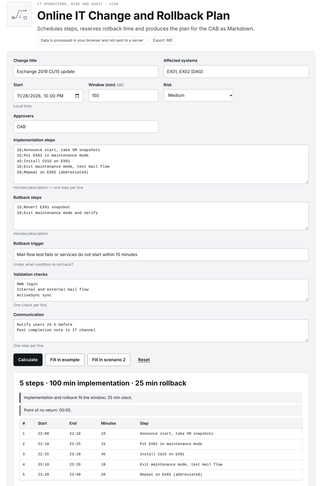

# IT Change and Rollback Plan

Build a Markdown change plan with a timeline, point of no return for rollback and validation checklist from change steps; warns if the window is too short.

## Try it live

- [Türkçe](https://uyum.eretek.com/araclar/degisiklik-geri-donus-plani)
- [English](https://uyum.eretek.com/en/tools/change-rollback-plan)
- [Deutsch](https://uyum.eretek.com/de/werkzeuge/change-rollback-plan)



## What it does

Schedules steps, reserves rollback time and produces the plan for the CAB as Markdown.

The most common mistake in maintenance windows is continuing implementation until the last minute without reserving rollback time. The tool schedules implementation steps by duration, subtracts rollback time from the window to calculate the point of no return and creates a plan with checklists.

## Where it helps

Share the plan before the CAB meeting and record real durations for the next change. Check the SLA budget of affected services with the SLA tool.

## How to use it

1. Enter title, systems, start, window length, risk and approvers.
2. Enter implementation and rollback steps as `minutes;description` one per line; add the rollback trigger, validation checks and communication steps.
3. Press Run; download the Markdown plan and attach it to the change record.

### Fields

| Field | Description |
|---|---|
| Change title |  |
| Affected systems |  |
| Start | Local time. |
| Window (min) |  |
| Risk |  |
| Approvers |  |
| Implementation steps | minutes;description — one step per line. |
| Rollback steps | minutes;description |
| Rollback trigger | Under what condition to roll back? |
| Validation checks | One check per line. |
| Communication | One step per line. |

## Example input

Press **Fill in example** in the tool to load this input.

| Input | Value |
|---|---|
| Change title | `Exchange 2019 CU15 update` |
| Affected systems | `EX01, EX02 (DAG)` |
| Start | `2026-11-28T22:00` |
| Window (min) | `150` |
| Risk | `Medium` |
| Approvers | `CAB` |
| Rollback trigger | `Mail flow test fails or services do not start within 15 minutes` |

**Implementation steps**

```text
10;Announce start, take VM snapshots
15;Put EX01 in maintenance mode
45;Install CU15 on EX01
10;Exit maintenance mode, test mail flow
20;Repeat on EX02 (abbreviated)
```

**Rollback steps**

```text
15;Revert EX01 snapshot
10;Exit maintenance mode and verify
```

**Validation checks**

```text
OWA login
Internal and external mail flow
ActiveSync sync
```

**Communication**

```text
Notify users 24 h before
Post completion note to IT channel
```

**Expected result:** 5 implementation steps take 100 min, rollback 25 min; 25 min of slack in a 150-minute window. Point of no return 00:05: if validation fails at this time, rollback must start.

## Method and assumptions

Step start = sum of previous steps. Point of no return = start + (window − rollback time). Slack = window − implementation − rollback; negative gives a warning.

## Limits and common mistakes

- Steps are sequential; parallel steps and dependencies are not modelled. The plan content is user input; technical correctness is not checked.

## Run it locally

The tool is plain HTML, CSS and JavaScript with no build step and no dependencies.

```bash
git clone https://github.com/eretek/change-rollback-plan.git
cd change-rollback-plan
node scripts/serve.js        # or: python3 -m http.server 8080
```

Open <http://127.0.0.1:8080/>. Add `?lang=tr` or `?lang=de` for Turkish or German; without it the page follows the browser language and falls back to English. You can also open `index.html` directly from disk.

Run the tests (Node.js 18 or later):

```bash
node test/run.js    # or: npm test
```

The tests run the tool's own fixtures and the worked examples in all three languages without a browser.

## How it works

All processing happens in your browser. The tool makes no network requests, uses no cookies or browser storage, and does not upload files you select.

No server-side component is needed. The version on the Eretek website renders the same page through a private WordPress plugin; that plugin only produces the page markup and is not part of this repository.

| Path | Purpose |
|---|---|
| `index.html` | Page shell |
| `src/app.js` | Builds the page in Turkish, English or German from `src/data.js` |
| `src/data.js` | Field definitions, examples and all texts in three languages |
| `src/core.js` | Shared runtime: validation, number formats, result rendering, CSV/ICS export |
| `src/tool.js` | The calculation or analysis for this tool |
| `docs/screenshot.png` | Screenshot used in this README |
| `src/tools.css`, `src/page.css` | Styles |
| `test/run.js`, `test/cases.json` | Headless tests |

## License and attribution

This tool is released under the [Eretek Website Attribution License](LICENSE). You may use, modify and redistribute it, including commercially. If you make it available on a website or web application, show a visible, clickable credit linking to https://eretek.com/ on every page where the tool is available, for example:

```html
<a href="https://eretek.com/">Powered by Eretek</a>
```

You may add `rel="nofollow"` to the link. Keep the copyright notice and license text in copies and redistributions.
